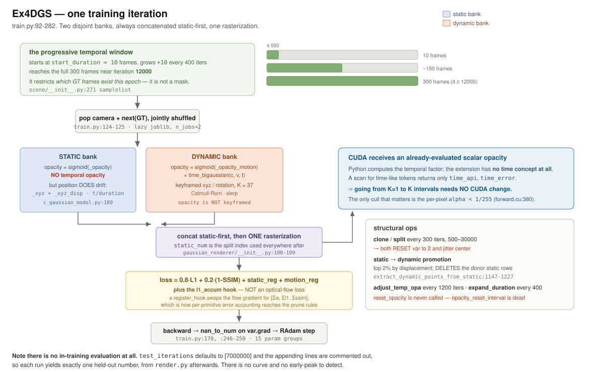
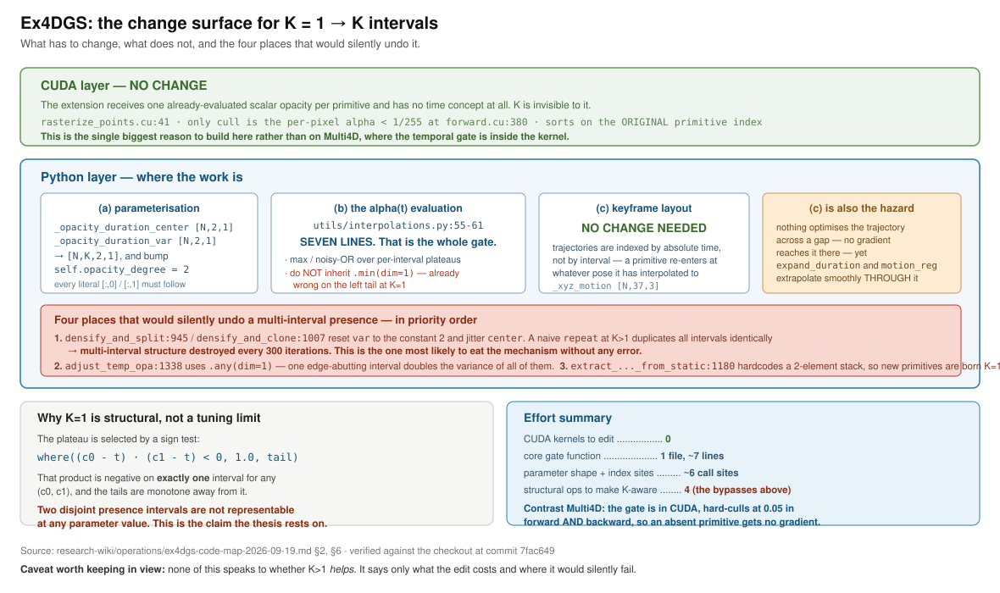
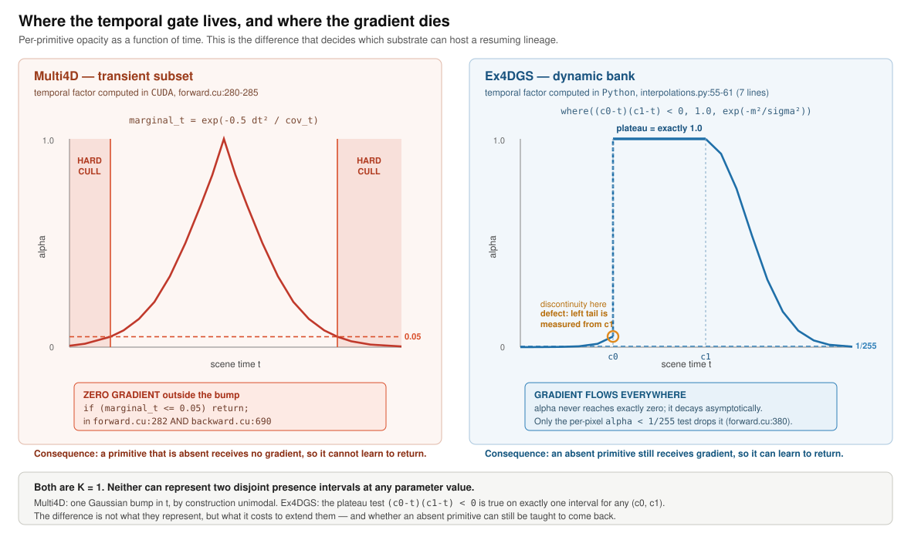
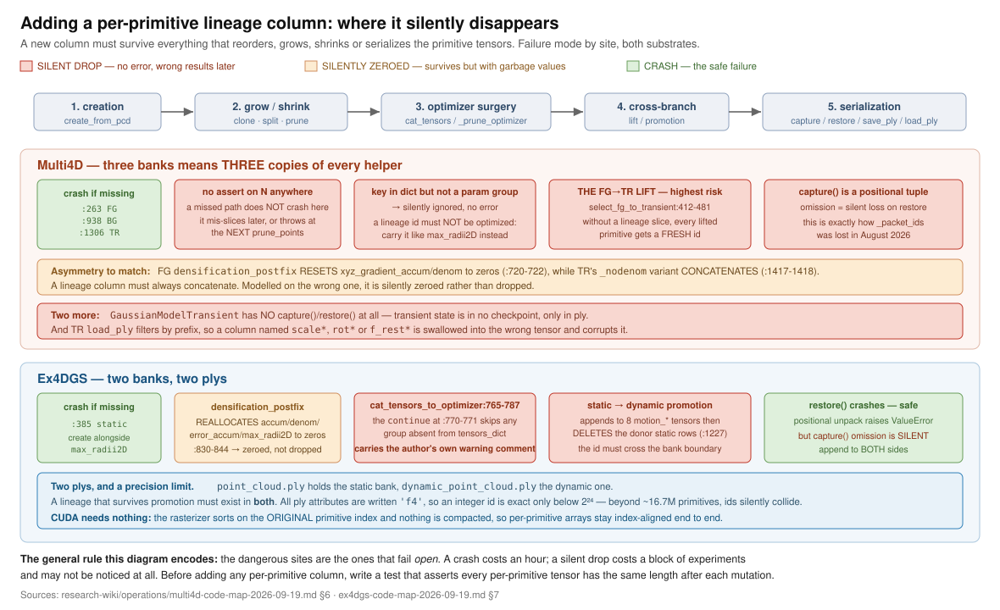

# Ex4DGS code map (commit `7fac649`)

Purpose: make later small diffs reviewable by someone who has not read the
codebase. Static read, 2026-09-19. **Items marked (verified) were re-read
independently against the checkout before entering this record.**

Reproduction result, gates and environment:
[`ex4dgs-n3v-leonardo-reproduction-2026-09-19`](ex4dgs-n3v-leonardo-reproduction-2026-09-19.md).
Companion: [`multi4d-code-map-2026-09-19`](multi4d-code-map-2026-09-19.md).

Two disjoint banks, never unified: **static** (`_xyz`, `_features_*`,
`_scaling`, `_rotation`, `_opacity`, `_xyz_disp`) and **dynamic**
(`_xyz_motion`, `_features_*_motion`, `_scaling_motion`, `_opacity_motion`,
`_opacity_duration_center`, `_opacity_duration_var`, `_rotation_motion`). Every
render concatenates **static-first, dynamic-second**; `static_num =
gaussians._xyz.shape[0]` is the split index used downstream (`train.py:204`,
`:229`, `:278`).

## 0. Figures



*Ex4DGS, one training iteration: the progressive temporal window, the two banks,
the single rasterization, and the fact that CUDA receives an already-evaluated
scalar opacity. Detail in §1 and §4.*



*What changes to go from one presence interval to K, what does not, and the four
places that would silently undo it. Detail in §2 and §6.*



*The comparison that decides the substrate choice: Ex4DGS's temporal factor is
smooth and never exactly zero, so an absent primitive still receives gradient.
Detail in §2, §4 and §10.*



*Every site a new per-primitive column must survive. Detail in §7.*

## 1. One training iteration

Loop body `train.py:92-282`.

* LR `:110` → `c_gaussian_model.py:461-471`. **`update_learning_rate` returns inside the loop on the first match**, and `param_groups[0]` is `"xyz"` (`:431`), so the `elif "motion_xyz"` branch at `:468-471` is **unreachable**: `dynamic_position_lr_final/_delay_mult/_max_steps` are dead and `motion_xyz` holds `dynamic_position_lr_init * spatial_lr_scale` for all 40000 iterations.
* Epoch refill `:117-123` → `scene/__init__.py:185-204`. The **progressive window** is `scene.samplelist` (`:271`): only cameras with `timestamp <= sample_len` are in the stack, so the window restricts *which GT frames exist this epoch*, it is not a mask.
* Camera/GT `:124-125`, paired and jointly shuffled at `scene/__init__.py:190-194`. Background `torch.rand((3))` per iteration `:136`.
* Render `:138` → `gaussian_renderer/__init__.py:19-124`. **Static Gaussians are not time-invariant in position**: `_xyz + _xyz_disp * t/duration` (`c_gaussian_model.py:180`). They are time-invariant only in *opacity*.
* Loss `:144-145`: `0.8*L1 + 0.2*(1-SSIM)`.
* **The `l1_accum` channel `:148-153`** is not an optical-flow loss. `flow.register_hook` replaces the rendered-flow gradient with `stack([acc, l1, ssim])` and `loss += flow.mean()*0` keeps it in the graph, so the `_df` rasterizer's flow backward deposits per-primitive `[Σα, Σl1, Σssim]` into `flow.grad`. That is Ex4DGS's per-primitive error accounting, consumed by `mark_prune_stats` (`:200`) and `add_l1_ssim_stats` (`:215`).
* `static_reg` 1e-4 on `log‖_xyz_disp‖` `:156-157`; `motion_reg` 1e-4 on **first keyframe vs all others** (`:159-161`), not successive differences; `rot_reg` defaults 0.
* Backward `:170`; `_opacity_duration_var.grad.nan_to_num()` **before** `step()` (`:246-250`); RAdam over 15 groups (`:430-449`); `prune_nan_points()` and `empty_cache()` every iteration.

## 2. The temporal opacity parameterisation — the core section

**(verified) `utils/interpolations.py:55-61`:**

```python
def time_bigaussian(mean, var, t, training=False, var_min=0.1):
    m =  (t - mean).min(dim=1)[0]
    v = torch.where((t > mean).any(dim=1), var[:, 1], var[:, 0])
    opacity_ = m.pow(2) / (v.exp() + var_min/2.36).pow(2)
    opacity_ = torch.exp(-1*opacity_)
    return torch.where( (mean[:, 0] - t) * (mean[:, 1] - t) < 0, torch.ones_like(opacity_), opacity_)
```

`training` is accepted and never used. Called from
`c_gaussian_model.py:363-366`, which rescales `t` into keyframe-index units and
multiplies by `sigmoid(_opacity_motion)`.

Learnable: `_opacity_motion` `[N,1]`, `_opacity_duration_center` `[N,2,1]`,
`_opacity_duration_var` `[N,2,1]`, with `self.opacity_degree = 2` (`:86`) the
only place the endpoint count is written. Optimizer groups `:443-445`.

**Shape of α(t).** Inside `(c0,c1)` the `where` returns **exactly 1.0** — a flat
plateau, so α = `sigmoid(_opacity_motion)`. Outside it decays as
`exp(-m²/σ²)`. **It is never exactly zero**; the only thing that produces true
absence is the rasterizer's per-pixel `alpha < 1/255` test (§4).

**(verified) Support is a single contiguous interval BY CONSTRUCTION.** The
plateau test `(c0-t)(c1-t) < 0` is true on exactly one interval for any
`(c0,c1)`, and the tails are monotone away from it. **Two disjoint presence
intervals are not representable at any parameter value.** This is the K=1 fact
the thesis rests on, and it is structural rather than a matter of tuning.

**(verified) The static subset has no temporal opacity.** `get_opacity`
(`:355-357`) is `sigmoid(self._opacity)` with no time argument, returned
unchanged for the static block by `get_opacity_at_t` (`:368-375`).

**Asymmetry defect, flag for any diff.** `m = (t - mean).min(dim=1)[0]`
(`:56`). For `t > c1` this is `t - c1`, the distance to the near edge. For
`t < c0` it is *also* `t - c1` — the distance to the **far** edge. So the left
tail is measured from the offset, not the onset, and α jumps discontinuously
from `exp(-(c1-t)²/σ²)` to `1.0` at `t = c0`. The right tail is continuous. **A
K-interval rewrite must not inherit `.min(dim=1)`.**

Scalars: `interval = time_interval = 10` (keyframe spacing); `time_pad = 2`;
`time_shift = 12`, then `+= interval` for `cube` (`:119`) so the 4-point
Catmull-Rom stencil has `t_idx-1`; `var_pad = 3` → `var_min = 0.3`;
`kernel_size = 0.1` is the Mip-Splatting 2D dilation with **no temporal role**;
`keyframe_num = 37` measured.

## 3. Keyframe tensors

`_xyz_motion` `[N,K,3]` (`:79`), `_rotation_motion` `[N,K,4]` (`:87`). **Opacity
is not keyframed** — it is the 2-endpoint form of §2. Evaluated by
`get_dynamic_xyz_at_t` (`:182-193`) and `get_dynamic_rotation_at_t` (`:203-215`),
both computing `t_idx = t//interval`, `delta_t = (t%interval)/interval`, then
Catmull-Rom (`interpolations.py:81-93`) or slerp (`:33-52`).

**Three mutually inconsistent `keyframe_num` formulas**: `load_ply:603` (`+4`),
`expand_duration:1254` (`+2`), `extract_dynamic_points_from_static:1166`
(`time_shift*2`, `+2`). Measured on a real 40k checkpoint: 63,862 dynamic
primitives with `motion_xyz_0_0 … motion_xyz_36_2`, i.e. **K = 37**, which
`load_ply:603` reproduces exactly from `duration=300, time_shift=12,
time_pad=2, interval=10`. Which call produced the final width was **not**
settled (the `expand_duration` arithmetic predicts 36 for the terminal
`duration=313`) — recorded as unverified. The operational consequence is
unambiguous either way: **`load_ply` reconstructs K arithmetically and never
reads it from the file**, so it is correct only at exactly the
duration/time_pad/time_interval/interp_type the checkpoint was trained at.
Under-allocation raises `IndexError` at `:610`; over-allocation silently leaves
trailing zero keyframes.

## 4. The presence / cull path

**(verified) There is no temporal-support test anywhere in CUDA, and CUDA has no
time concept at all.** A case-insensitive scan of
`submodules/diff_gaussian_rasterization_df/` for time-like tokens returns only
incidental identifiers (`time_api`, `time_error`). Python evaluates the temporal
opacity and hands CUDA one already-evaluated scalar per primitive
(`gaussian_renderer/__init__.py:64` → `:106` → `rasterize_points.cu:41`).

Python guards: the three asserts `t >= -time_shift and t <= duration+time_shift`
(`:171`, `:196`, `:369`); `visibility_filter = radii > 0`
(`gaussian_renderer/__init__.py:122`).

**(verified) Dead code at `c_gaussian_model.py:1078-1081`**: the
degenerate-interval prune computes
`torch.logical_or(dynamic_prune_mask, |c1-c0| < 0.5/interval)` and **never
assigns the result**. Only the `motion_xyz_error_min_timestamp < 0` mask
survives. A K-interval degeneracy check placed there would be equally dead.

CUDA culls: frustum and near/far via `auxiliary.h:267,284` with
`min_depth=near=4.0`, `max_depth=far=300.0`; degenerate covariance
`forward.cu:232-234`; zero tile overlap `:248-250`; **per-pixel
`alpha < 1/255` at `forward.cu:380-381`**; transmittance stop `test_T < 1e-4`.

**Consequence:** a zeroed opacity does *not* set `radii=0`, so the primitive is
still preprocessed, binned, sorted and fetched before being dropped per-pixel.
Exact-zero presence is correct but costs full pipeline work.

## 5. Densify / prune / make-dynamic

| op | call | implementation | schedule | subset | effect |
|---|---|---|---|---|---|
| clone | `:224` | `:966-1017` | 500–30000, every 300 | both | creates; dynamic clones jitter `center` by `randn` and **reset `var` to 2** (`:1007`) |
| split | `:224` | `:874-964` | same | both | creates 2 offspring, destroys parents (`:964`); same jitter + `var←2` (`:942-945`) |
| opacity/size/error prune | `:224` | `:1019-1072` | same | both | destroys. `size_threshold` is **`None` at every call site** (`:218`), so the screen-size branches never fire. ssim/l1 thresholds only bite at `it > 20000` and `it % 1500 == 0`. |
| **static→dynamic promotion** | `:232`, `:280` | `extract_dynamic_points_from_static:1147-1227` | `it % extracton_interval == 3980`, and armed at `it % 400 == 100` | static→dynamic | appends to all 8 `motion_*` tensors then **deletes the donor static rows** (`:1227`). Top 2% by `‖_xyz_disp‖/‖x-cam‖²`. Initial interval seeded from `xyz_error_min_timestamp` (`:1178-1187`). |
| `adjust_temp_opa` | `:233-234` | `:1330-1358` | `it % 1200 == 0`, `it < 27000` | dynamic | doubles `var` for intervals abutting a window edge, clamps `center`, floors `var` at 0.5 |
| `expand_duration` | `:75`, `:267` | `:1243-1297` | `it % 400 == 0` | dynamic | extrapolates the last ≤4 keyframes; `replace_tensor_to_optimizer` **zeroes RAdam moments** (`:679-680`). `:1276` adds `time_shift/interval` to centers already in shifted units — inconsistent with `adjust_temp_opa:1338`, which does not. |
| `prune_invisible` / `prune_small` / `prune_nan_points` | `:237-240`, `:253` | `:1074-1085`, `:1087-1093`, `:1229-1241` | — | both | destroy |
| `reset_opacity` | — | `:549-558` | **never called** | — | `opacity_reset_interval` is read nowhere |

## 6. K = 1 → K intervals — and why this substrate is the cheap one

**(a) Parameterisation.** `_opacity_duration_center`/`_var` `[N,2,1]` → `[N,K,2,1]`
or flattened; `self.opacity_degree = 2` (`:86`). Every literal `[:,0]`/`[:,1]`
must follow: `:941-945`, `:1003-1007`, `:1080`, `:1180-1187`, `:1276-1279`,
`:1338-1344`.

**(b) α(t).** `utils/interpolations.py:55-61` is the whole of it — seven lines.
A K-interval form is a max (or noisy-OR) over per-interval plateaus. Two traps:
`.min(dim=1)` must become a per-interval signed distance (it is already wrong on
the left tail at K=1), and the plateau test must become a per-interval `any`.
The call site `c_gaussian_model.py:365` passes the whole tensor and needs no
change if the contract is kept.

**(c) Keyframe layout.** **No change required** — trajectories are indexed by
absolute time, not by interval. *But this is also the silent hazard*: nothing
optimises the trajectory across a gap (no gradient reaches it there), while
`expand_duration`'s extrapolation and `motion_reg` will happily produce a smooth
path *through* an absence the model claims is empty.

**(d) CUDA. (verified) Nothing to change.** K is invisible to the extension.

**Silent bypasses, priority order:**
1. `densify_and_split:945` / `densify_and_clone:1007` **reset `var` to the constant 2** and jitter `center`. At K>1 a naive `repeat` would duplicate all intervals and jitter them identically — **multi-interval structure destroyed every 300 iterations.**
2. `adjust_temp_opa:1338-1344` uses `.any(dim=1)`: one edge-abutting interval would double the variance of all of them.
3. `extract_dynamic_points_from_static:1180-1187` hardcodes a 2-element stack, so new primitives are born K=1 regardless.
4. `load_ply:633-643` allocates `np.zeros((N, opacity_degree, 1))`; without bumping `opacity_degree`, extra intervals in the file are silently discarded.

## 7. Lineage column

Two plys: `point_cloud.ply` = static bank, `dynamic_point_cloud.ply` = dynamic
bank (`save_ply:513-547`). A lineage that survives promotion must exist in both.

**The most dangerous path is `cat_tensors_to_optimizer:765-787`**, whose
`continue` at `:770-771` (carrying the author's own comment
`# warning this may skip invaild paramgroups`) silently skips any group not in
`tensors_dict`. The dynamic bank grows, the lineage column does not,
**lengths desynchronise with no error at the growth site**.

Other sites: creation `:385-410` (static) and `:1191-1211` (dynamic);
`densification_postfix:789-844` — note it **reallocates** `xyz_gradient_accum`,
`denom`, `error_accum`, `max_radii2D` to zeros (`:830-844`), so a column modelled
on those would be **zeroed, not dropped**; `prune_points:715-763` masks
non-parameter tensors individually, so an unlisted one keeps its old length and
silently mis-indexes; `capture:217-260` omission is a **silent** checkpoint loss,
while `restore:262-304` positional unpacking gives a **crash**, the safe failure.
All ply attrs are `'f4'` (`:525`, `:542`), so an integer id is exact only below
2²⁴. CUDA needs nothing: `rasterizer_impl.cu:108` sorts on the **original**
index and `out_idx` already returns original indices.

## 8. RNG

`utils/general_utils.py:158-161` hardcodes seed 0; no `--seed` flag. Draws:
`random.shuffle` once per epoch (`scene/__init__.py:192`); **`torch.rand((3))`
every iteration** for the random background (`train.py:136`); `torch.normal` in
both split paths (`:890`, `:927`); four `randn_like` center jitters (`:942-943`,
`:1004-1005`). `uuid.uuid4()` at `train.py:290` is **not** seed-controlled but
only fires when `model_path` is empty.

**A seed sweep cannot make two runs bitwise identical**: CUDA atomics in the
rasterizer backward (`backward.cu:613`, `:678-679`) are nondeterministic
regardless of seed. This is the mechanism behind the measured 0.6224 dB spread.

## 9. Config traps

`train.py:398-408` discards unregistered keys with `failed set config: <k>`.

* **`mini_batch` and `lambda_flow` are rejected** (zero hits repo-wide).
* **`opacity_reset_interval` is accepted and dead** — `reset_opacity` has no caller. This is what invalidated the planned A/B arm.
* Other accepted-but-dead defaults: `coord_reg`, `rot_reg` (0), `llffhold` (not on this loader path), and `dynamic_position_lr_final/_delay_mult/_max_steps` (unreachable per §1).
* `loadCamVideoss:255` hardcodes half resolution and per-scene `im_scale` hacks, but is **unreachable** (`ss=False` default, never overridden).

**`render.py` merge asymmetry.** `ModelParams(parser, sentinel=True)`
(`render.py:144`) forces its defaults to `None`, so all of `ModelParams` comes
from the training `cfg_args`. But `OptimizationParams` and `PipelineParams` are
built **without** sentinel (`:145-146`), so their CLI defaults **overwrite** the
trained values. Additionally `render.py:128` constructs the model without
`rot_interp_type`, `var_pad`, `kernel_size`, which fall back to constructor
defaults (`'slerp'`, `3`, `0.1`) even though `cfg_args` carries them. **`var_pad`
feeds `var_min` in `time_bigaussian` and `kernel_size` feeds the rasterizer
dilation**, so changing either for training would be silently ignored at render.
Our E0 was unaffected only because the trained values happen to equal the
defaults.

## 10. Substrate comparison — where the temporal gate lives

This is the decisive structural difference between the two candidates.

| | Multi4D | Ex4DGS |
|---|---|---|
| temporal opacity computed in | **CUDA** (`forward.cu:280-285`) | **Python** (`interpolations.py:55-61`, 7 lines) |
| form | one Gaussian bump in t | flat plateau + Gaussian tails |
| hard cull | **`marginal_t > 0.05`, early `return`** | none; only the standard per-pixel `alpha < 1/255` |
| gradient outside the interval | **zero** — `backward.cu:687-692` returns before any gradient is written | nonzero; α decays smoothly and is only dropped per pixel |
| CUDA change needed for K intervals | **yes** | **no** |
| which subsets carry time | transient only (FG/BG have none) | dynamic bank only (static has none) |

**The gradient row is the one that matters for a resuming lineage.** On Multi4D a
primitive outside its bump receives no gradient at all, so it cannot learn to
re-activate; the `0.05` threshold is an order of magnitude above the `1/255`
raster floor, so the dead band is wide. On Ex4DGS the temporal factor is smooth
everywhere and the only cutoff is the standard per-pixel alpha test.
