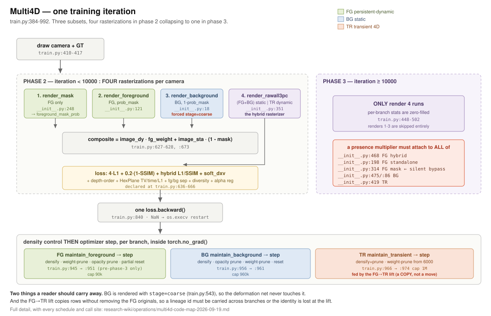
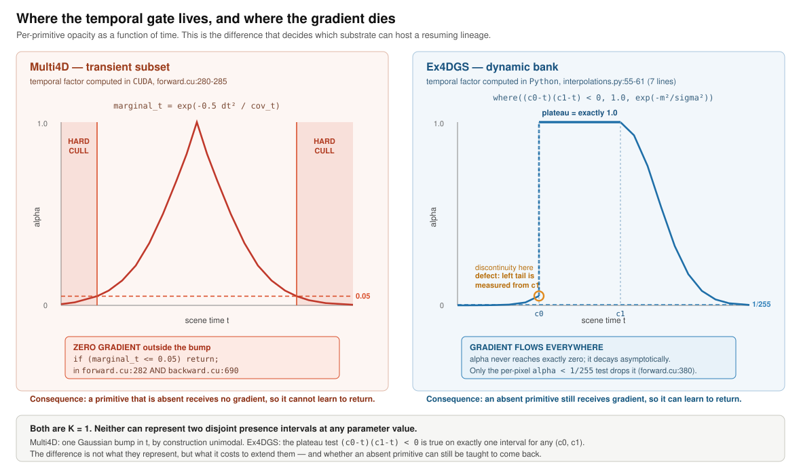
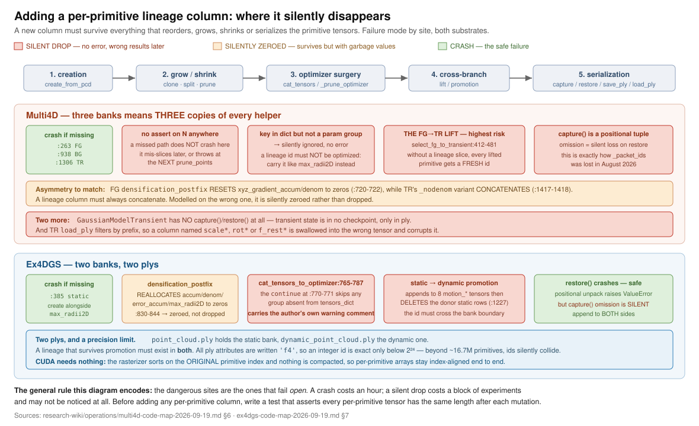

# Multi4D code map (commit `c483e82`)

Purpose: make later small diffs reviewable by someone who has not read the
codebase. Produced by static read on 2026-09-19. **Items marked (verified) were
re-read independently against the checkout before entering this record**; the
rest are single-source and should be re-checked before anything load-bearing
rests on them.

Reproduction result and environment:
[`multi4d-n3v-leonardo-reproduction-2026-09-18`](multi4d-n3v-leonardo-reproduction-2026-09-18.md).

Three subsets: **FG** persistent-dynamic `GaussianModel_dynamic`
(`scene/gaussian_model.py:147`), **BG** static `GaussianModel` (`:828`), **TR**
transient 4D `GaussianModelTransient` (`:1231`). Built at `train.py:1005-1013`
with `rot_4d=True`, `sh_degree_t=2`, `gaussian_dim=4`. Coarse 2000 then fine
20000 as two `scene_reconstruction` calls (`train.py:1026`, `:1038`), each
restarting the counter. Phase boundaries: `transient_merging_iter=3000`,
`phase3_start_iter=10000`, `densify_until_iter=16000`.

## 0. Figures



*Multi4D, one training iteration: the three subsets, the four rasterizations of
phase 2 collapsing to one in phase 3, and the five sites a presence multiplier
must attach to. Detail in §1 and §5.*



*Where the temporal gate lives in each substrate and where the gradient dies.
Multi4D's transient bump is hard-culled at `marginal_t > 0.05` in both
`forward.cu` and `backward.cu`, so an absent primitive receives no gradient.
Detail in §2 and §3.*



*Every site a new per-primitive column must be threaded through, coloured by
failure mode. The dangerous ones fail open. Detail in §6.*

## 1. One fine-stage iteration

Loop body `train.py:384-992`.

* Predicates `:389-391` — `in_phase3 = iteration >= 10000`, `after_merge = iteration > 3000`.
* LR/SH `:394-404`; TR's LR update is deferred to `:977`.
* Camera draw `:410-417` — `randint` pop from a shuffled index list, refilled per epoch. GT read at `:539` (phase 2) / `:458` (phase 3).
* **Phase 2 runs four rasterizations per camera** (`:504-581`):
  1. `render_mask` (`gaussian_renderer/__init__.py:248`) — FG only; `mask_dy = sigmoid(shs_final[:,-1,2])` (`:325`) thresholded at 0.5 → `foreground_mask_prob` (`train.py:510-512`).
  2. `render_foreground` (`:121`) with `prob_mask=foreground_mask_prob`.
  3. `render_background` (`:18`) with `prob_mask=1-foreground_mask_prob`, **forced `stage='coarse'`** (`train.py:543`) so the deformation net never touches BG.
  4. `render_rawall3pc` (`:351`) — the hybrid pass: FG+BG concatenated as the "static" set (`:482-489`), TR as the "dynamic" set, one `GaussianRasterizer_hybrid` call (`:504-524`).
* **Phase 3 runs only render 4** (`train.py:448-502`); per-branch stats zero-filled.
* Composition `:627-628`, `:673`: `image = image_dy*fg_weight + image_sta*(1-mask)`.
* Loss map declared at `:636-666`. `lambda_main_loss=4`, `lambda_ssim=0.2`. Principal terms: composite L1+SSIM (`:705-709`), hybrid L1 (`:746`) and hybrid SSIM after merge (`:748-750`), `soft_dxv` 0.005 (`:713-730`), depth-order 0.01 phase-3 only (`:735-741`), HexPlane TV/time/L1 fine-only (`:760-764`), fg/bg separation 0.01 (`:770-777`), diversity 0.1 (`:782-783`), `render_3d` anchor 0.1 (`:785`), alpha reg 0.01 after 3000 (`:787-795`).
* One `loss.backward()` at `:840`; NaN triggers `os.execv` restart (`:843-845`).
* Density control **then** optimizer step, per branch, inside `torch.no_grad()` (`:871`): FG `maintain_foreground` `:945` → step `:951`; BG `:956` → `:961`; TR `:966` → `:974`.
* Eval every 500 fine iters `:989-992`; debug viz every 100 `:896`.

## 2. Time and opacity, per subset

| subset | alpha handed to the rasterizer | time dependence |
|---|---|---|
| **BG** | `sigmoid(self._opacity)` (`gaussian_model.py:100-107`), used at `gaussian_renderer/__init__.py:475` | **none** |
| **FG** | `sigmoid(opacity_final)` (`gaussian_renderer/__init__.py:198`, hybrid `:468`), `opacity_final` from `pc._deformation(...)` | **none under the shipped config.** `scene/deformation.py:76-80` gates opacity deformation on `enable_do_deform`, which `arguments/dynerf.py:45` sets **False**. Time reaches FG only via position (`deformation.py:61-64`, damped `dx/10`), rotation (`:71-75`) and the SH mask channel (`:84-85`), all through the HexPlane query at `:49` |
| **TR** | python `sigmoid(_opacity)` (`gaussian_renderer/__init__.py:419`), then CUDA multiplies a temporal marginal | **yes — one unimodal Gaussian bump in t** |

**(verified) The TR temporal gate, `diff_gaussian_rasterization_hybrid/cuda_rasterizer/forward.cu:278-285`:**

```c
float cov_t = Sigma[3][3];
float marginal_t = __expf(-0.5 * dt * dt / cov_t);
mask = marginal_t > 0.05;
if (!mask)
  return;
opacity *= marginal_t;
```

**(verified) The identical cull exists in `backward.cu:687-692`**, so a TR
primitive outside its bump receives **no gradient at all**.

**Consequence for the thesis.** The only place any Multi4D primitive can be
absent at some times and present at others is TR, and its support is a *single*
Gaussian in t, hard-truncated at 0.05. There is no per-primitive interval list
anywhere, and no mechanism for present → absent → present. FG and BG presence is
a scalar with no temporal argument. **A multiplier cannot create a second
interval on TR**, because the CUDA gate returns before opacity is read and gives
zero gradient on the far side.

**(verified) `opa_threshold=0.005` (`gaussian_renderer/__init__.py:410`) is dead
code**: it is only read in the `gaussian_dim==4 && !rot_4d` branch
(`forward.cu:359-364`), and `train.py:1010` sets `rot_4d=True`. Tuning it would
measure nothing. The live constant is the hardcoded `0.05`.

A per-primitive presence multiplier already exists in the right place, as
stochastic dropout: `gaussian_renderer/__init__.py:87-94, 202-209, 315-322,
492-502`, `opacity = opacity * compensation[:, None]`, rate 0.1.

## 3. Cull path

1. **TR temporal hard cull** — `forward.cu:282-284` (above), mirrored in `backward.cu:690-692`. Sets `radii=0`, `tiles_touched=0` (`:325-326`).
2. **Rasterizer alpha floor** — `forward.cu:651-654`, `alpha < 1/255 → continue`; also `backward.cu:1060`, `:1374`, and the non-hybrid rasterizer.
3. **Early ray termination** — `forward.cu:663-667`, `test_T < 1e-4`.
4. **Frustum/radius** — `:371-372`, `:401-403`, `:455-456`, `:497-499`.
5. **`radii > 0` visibility filters** (stats only) — `gaussian_renderer/__init__.py:116, 237, 545, 555, 558`.
6. **Opacity prunes** at 0.005 — FG `train.py:99`, BG `:139`, TR `gaussian_model.py:1691`.
7. **`max_weight` utility prune**, computed `prob_mask`-weighted in CUDA — `forward.cu:694-704`.

## 4. Densify / prune / lift

| mechanism | call site | implementation | schedule | subset | effect |
|---|---|---|---|---|---|
| FG densify | `train.py:75-77` | `gaussian_model.py:119` → `:764`/`:731` | >500, every 100, <90000, pre-phase-3 | FG | creates (split destroys parents `:760-762`) |
| FG weight-prune | `:94` | `:483` | every 100, 3000–10000, thresh 0.01→0.1 | FG | destroys |
| FG opacity prune | `:99` | `:126` | >500, every 600 | FG | destroys |
| FG opacity reset | `:104` | `:570` (random 50%) | every 2000, <10000 | FG | neither |
| BG densify | `:132-134` | `:1198`/`:1170` | >500, every 100, <960000 | BG | both |
| BG opacity prune | `:139` | `:126` | >500, every 600 | BG | destroys |
| BG weight-prune | `:147` | `:1217` | every 500, 3000–10000 | BG | destroys |
| BG opacity reset | `:143` | `:925` (random 70%) | every 2000, <16000 | BG | neither |
| TR densify+prune | `:206` | `:1684` → `:1656`/`:1598` | >500, every 100, <1e6, thresh/2 | TR | both |
| **FG→TR lift** | donors `:921-934`, ingest `:210-212` | `:361` `compute_transfer_state`, `:412` `select_fg_to_transient`, `:1430` → `:1350` → `:1388` | every 50, 3000–10000, `dynamic_score > 0.05`, capped 2000 | reads FG, **creates TR** | creates |
| TR weight-prune | `:229` | `:1525` | every 200, >6000, thresh 0.005→0.02 | TR | destroys |

**There is no structural "transient merge".** `transient_merging_iter=3000`
only admits the hybrid SSIM term, opens FG/BG weight-prune, and starts the donor
window. **FG rows are not removed at the lift** — it is a copy, not a move.

## 5. Where a presence multiplier would attach

Minimum set so it renders, receives gradient, and is not bypassed:

* FG hybrid `gaussian_renderer/__init__.py:468` — before the `cat` at `:486` and before dropout at `:502`.
* FG standalone `:198` — omitting this leaves the phase-2 composite and region losses blind to the gate, which is exactly the post-hoc-vs-training-time split this project hit on 2026-09-10.
* **FG mask render `:314` — the most likely silent bypass.** Skipping it leaves `foreground_mask_prob`, `fg_region_weight`, `L_reg_alpha` and `L_sep_fgbg` all treating a gated primitive as present.
* BG `:475` (hybrid) and `:86` (standalone); TR `:419`.

All five are plain torch ops feeding the autograd `Function`
(`diff_gaussian_rasterization_hybrid.py:84`), whose backward returns
`grad_opacities` — **so a new parameter gets gradient with no CUDA change**,
provided it is registered in the relevant `training_setup` optimizer list
(`gaussian_model.py:319-336` FG, `:982-989` BG, `:1450-1465` TR).

Bypasses to guard: the TR CUDA gate (§2); BG forced to `stage='coarse'`
(`train.py:543`); `render_3d` is `.clone().detach()` in the diversity term
(`:497`, `:561`); `compute_transfer_state` runs under `no_grad` and
`select_fg_to_transient` copies **raw** `opacity_final` (`gaussian_model.py:442`)
then boosts it (`:469-470`), so a presence factor not folded in there is lost at
the lift. Prune criteria read the un-multiplied tensors, so a `p=0` primitive
keeps its `_opacity` but accumulates `max_weight=0` and dies at the next
weight-prune window.

## 6. Where a lineage column attaches — and what drops it

**(a) Creation.** FG `gaussian_model.py:263-297`, BG `:938-968`, TR `:1306-1347`,
plus the TR seeding path `scene/__init__.py:89-102` which builds TR from a
**one-point** cloud.

**(b) Optimizer surgery, three copies each.** `cat_tensors_to_optimizer` FG
`:673`, BG `:1122`, TR `:1538`; `_prune_optimizer` FG `:631` (note the
`len(group["params"]) > 1: continue` skip at `:634`), BG `:1088`, TR `:1483`.
**A key added to the `d` dict that is not an optimizer param group is silently
ignored** — no error. A lineage id must not be optimized, so it has to be
carried outside the optimizer, like `max_radii2D` / `_deformation_table`.

**(c) Every grow/shrink path** needs an explicit `cat`/mask line parallel to
`max_radii2D`: FG `:651-670`, `:700-729`, `:731-758`, `:764-781`; BG `:1106-1120`,
`:1148-1168`, `:1170-1196`, `:1198-1214`; TR `:1501-1523`, `:1564-1596`,
`:1388-1428`, `:1598-1653`, `:1656-1682`, `:1350-1387`, `:1430-1443`.

**The highest-risk drop is the lift**: `select_fg_to_transient:412-481` returns
FG-indexed slices (`:439-446`); without a lineage slice, every lifted primitive
gets a fresh id and the FG→TR identity — the exact thing a lineage column is
*for* — is lost.

**Failure mode.** None of these helpers assert on `N`, so a missed path does
**not** crash at the mutation site. It surfaces later as mis-sliced values or an
`IndexError` at the next `prune_points`. The `densify_and_split` paths are worst:
they postfix N×children then immediately `prune_points` with a mask sized to the
*new* total (`:760-762`, `:1194-1196`, `:1651-1653`). Note also that FG
`densification_postfix` **resets** `xyz_gradient_accum`/`denom` (`:720-722`)
while TR's `_nodenom` variant **concatenates** (`:1417-1418`) — a lineage column
must always concatenate.

**(d) Serialization.** `capture()` FG `:192-218`, BG `:862-885`; `restore()` FG
`:220-253`, BG `:887-915` — **fixed-length positional tuples**. Omitting the
column drops it silently across a restore; appending it breaks old checkpoints
with a tuple-unpack error. This is precisely how `_packet_ids` was lost in
August 2026.

**(verified) `GaussianModelTransient` has no `capture()` or `restore()` at all**
(a scan of the class body finds zero such definitions). `torch.save` at
`train.py:982-985` writes FG and BG only. **Transient state is in no checkpoint**
and survives only via ply — which sharpens the known resume defect: resume
restores FG, silently re-initialises BG, and TR was never saved in the first
place.

`save_ply`/`load_ply` FG `:550-567`/`:584-628`, BG `:1019-1036`/`:1039-1084`, TR
`:1731-1758`/`:1760-1825`, each driven by `construct_list_of_attributes`
(`:516-528`, `:1005-1017`, `:1708-1729`). All fields are written `'f4'`, so an
integer id is exact only below 2²⁴. **Naming hazard:** TR `load_ply` filters by
prefix (`:1786`, `:1793`) and explicitly excludes `scale_t`/`rot_r`, so a new
column whose name begins `scale`, `rot` or `f_rest` is swallowed into the wrong
tensor and silently corrupts it.

## 7. RNG — and a correction to the reproduction record

**(verified) The effective training seed is 0, not 6666.** `train.py:1085` calls
`setup_seed(6666)`, but `train.py:1113` then calls `safe_state(args.quiet)`,
which re-seeds `random.seed(0)`, `np.random.seed(0)`, `torch.manual_seed(0)`
(`utils/general_utils.py:125-127`). Model construction and `Scene2gs_mixed` both
run after that. What survives from `setup_seed` is
`torch.backends.cudnn.deterministic = True` (`train.py:1078`), which
`safe_state` does not touch. **A `--seed` flag must patch `safe_state`, not
`setup_seed`.** See §11 of the reproduction page for the append-only correction.

Draw sites during training: camera sampling `train.py:411`; **dropout on the
opacity compensation vector** at `gaussian_renderer/__init__.py:92, 207, 320,
498, 501` (five draws per camera pre-phase-3, two after — the largest consumer);
`torch.normal` in the split paths `gaussian_model.py:745, 1182, 1617, 1626,
1633`; `np.random.choice` in the opacity resets `:578`, `:933`; `torch.randperm`
donor subsampling `:433`; `torch.rand` TR times `:1315`.

## 8. Config: every key in `arguments/dynerf.py` is live

`utils/params_utils.py:1-8` applies a config key **only** `if hasattr(args, key)`
— an undeclared key is **silently ignored**, with no warning. The section header
in the config is decorative: `setattr` targets `args` globally, and routing to
parameter groups happens later by name membership
(`arguments/__init__.py:41-46`).

**Checked all 33 keys in `dynerf.py` against a declaration in
`arguments/__init__.py` and a consumer in the python: every one is declared,
applied and read. There is no dead knob in Multi4D's config** — in contrast to
Ex4DGS, where `opacity_reset_interval` is declared, applied and read by nothing,
which invalidated a planned experiment.

Traps that do exist:

* **`opa_threshold` is dead** (§2) — a constant, not a config key, so a config-key audit alone would not have caught it.
* **Bools defaulting to `True` cannot be disabled from the CLI.** `arguments/__init__.py:31-38` registers every bool as `action="store_true"` with `default=value`, so `eval` (`:56`) and `enable_transient_densify` (`:147`) are only settable `False` from a config file.
* **Conditionally dead, not dead:** `lambda_depth_order` additionally requires `depth_4d_list` non-empty, which only happens on the phase-3 render path, so setting it without reaching iteration 10000 is a silent no-op. Same shape for `dx_var_reset_interval`, read only when `use_soft_dxv_loss` is true.
* **Hardcoded schedule values not exposed as config:** FG weight-prune cadence 100 (`train.py:362`), BG cadence 500 and threshold 0.001 (`:146-147`), TR prune ramp 0.005→0.02 (`:227`), donor opacity boost +0.05 (`gaussian_model.py:470`), dropout rate 0.1 (four sites), `vis_thresh=0.49` (`train.py:632`), the `best/` gate `iteration > 16000` (`utils/eval_utils.py:145`).

## 9. Not determined

Whether the JIT-built hybrid extension loaded at runtime matches any prebuilt
artefact under `submodules/diff-gaussian-rasterization/build/` — the torch
extension cache was not inspected. Not load-bearing while the JIT build is
rebuilt from the tree each time, but worth checking before any CUDA edit.
